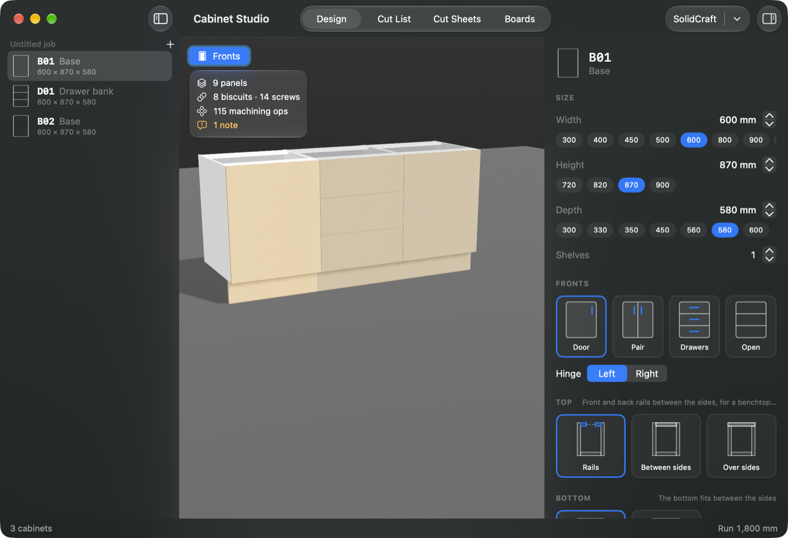
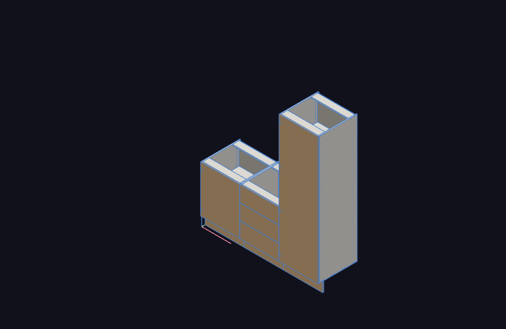

# CabinetForSolidcraft

**Turn boxes into cabinets in [SolidCraft](https://github.com/tangency-labs/solidcraft).** A Rust
cabinet engine with a native macOS app, Cabinet Studio. You choose how the panels come together
from pictures, not number fields. The app builds real solids in SolidCraft and produces cut lists
and dimensioned cut sheets.



> Early work in progress. See [docs/BACKLOG.md](docs/BACKLOG.md) for what is done and what is next.

## What works today

- Frameless base, wall, tall, drawer-bank and open-shelf cabinets.
- Visual pickers for the top (rails, between sides, over sides), bottom, back (grooved, applied,
  structural), toe kick (legs + plinth, plinth box, notched sides), door overlay, fixings, biscuit
  size and spacing.
- Joinery: #0/#10/#20 biscuits with a screw between each pair, screws-only, confirmat or dowels.
  Short joints such as rails are screwed.
- 32 mm system shelf-pin rows, hinge cups and mounting-plate holes. Shelf pins make way for
  hinge plates.
- **Build in SolidCraft:** each cabinet becomes a component of named panels. Manufacturing detail
  cuts every bore, groove and biscuit slot.
- A cut list with edge tape and cut sizes, CSV export, and an SVG cut sheet per part.
- Board catalog seeded from Polytec's availability guide (more Australian brands are on the way).



## Build

Requirements: macOS 15+, Xcode 26+, Homebrew, `brew install rustup xcodegen poppler`,
`rustup default stable`.

```bash
scripts/check.sh                      # tests + app build
open target/xcode/Build/Products/Debug/Cabinet\ Studio.app
```

Start SolidCraft with its control port so the app can reach it:

```bash
/Applications/SolidCraft.app/Contents/MacOS/SolidCraft --control 7878
```

## Supplier data

Hardware and board facts (dimensions, article numbers, sheet sizes) are kept as data with their
source in `catalog/`. Supplier CAD files (Blum, Häfele) go in `vendor-cad/`, which stays on your
machine and is never committed. This project is independent and not affiliated with Blum, Häfele,
Polytec, Laminex or Tangency Labs. Their names are used only to describe compatibility.

## Licence

MIT OR Apache-2.0.
