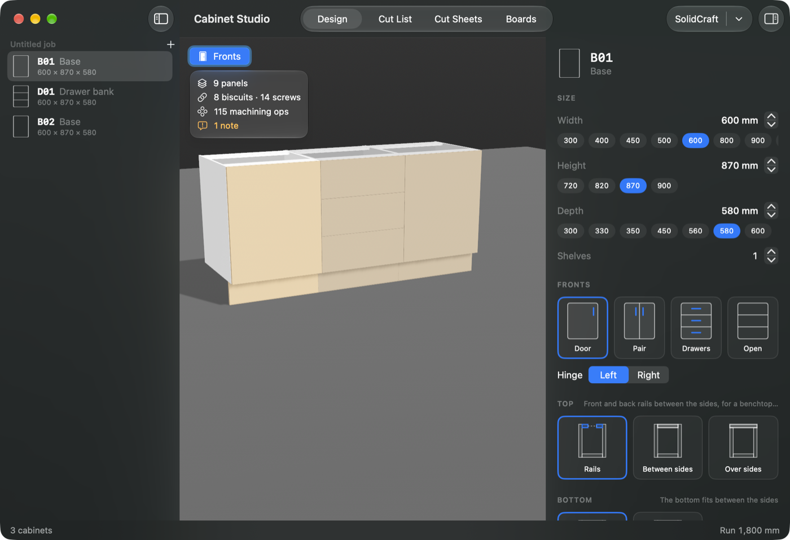
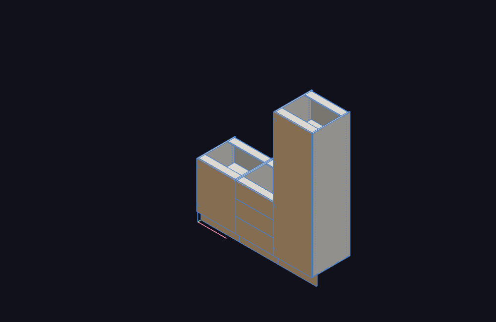

# CabinetForSolidcraft

**Turn boxes into cabinets in [SolidCraft](https://github.com/tangency-labs/solidcraft).** A Rust
cabinet engine with a native macOS app, Cabinet Studio. You choose how the panels come together
from pictures, not number fields. The app builds real solids in SolidCraft and produces cut lists
and dimensioned cut sheets.



> Work in progress: check every job against the supplier's documents before you cut. The catalog's
> data has not yet been verified against its suppliers. See [docs/BACKLOG.md](docs/BACKLOG.md) for what is
> done and what is next.

## Install

Download the latest zip from [Releases](https://github.com/brendan779/CabinetForSolidcraft/releases),
unzip it and move Cabinet Studio to Applications. It needs macOS 15 or later and isn't notarized, so
the first time, Control-click it and choose Open. The app can open SolidCraft for you: click the red
light beside the SolidCraft button.

## What works today

- **Cabinets:** frameless base, wall, tall, drawer bank, open shelf, sink, blind corner, L-corner,
  corner wall, wardrobe and rangehood canopy.
- **A whole run:** cabinets stand side by side with gaps, fillers and end panels, wall cabinets
  above. Base cabinets share one toe kick, joined at 2700 mm. Splashbacks in tile or sheet, floating
  shelves, cornices and light rails are run items too.
- **Pictures, not number fields:** the top, bottom, back, toe kick, door overlay, fixings, biscuit
  size and spacing are all chosen from drawn options.
- **Fronts:** slab, shaker and glass frame, with a shaker panel in its own board. Doors, pairs,
  drawers and sliding doors, split freely into sections. Front grain, arched tops, finger pulls,
  sharknose and edge pulls.
- **Appliance spaces:** oven towers and fridge housings. A fridge space has no plinth, back or
  bottom panel.
- **Hardware:** Blum hinges, LEGRABOX, MERIVOBOX, TANDEMBOX, MOVENTO and TANDEM drawers, TIP-ON and
  SERVO-DRIVE. Häfele AXILO legs, Minifix and shelf supports. ABI Interiors and generic handles.
- **Joinery:** #0/#10/#20 biscuits with a screw between each pair, screws only, confirmat, dowels,
  cam locks or DOMINO. Short joints such as rails are screwed. 32 mm shelf-pin rows and hinge holes,
  with shelf pins making way for hinge plates.
- **Boards:** Polytec, Laminex, EGGER, Formica, Nikpol and Trade Essentials decors, shown with
  woodgrain in the viewport, plus Polytec's linings.
- **Build in SolidCraft:** each cabinet becomes a component of named panels in your board colours,
  with supplier hardware models. Manufacturing detail cuts every bore, groove and biscuit slot.
- **Blender scenes:** the camera button beside SolidCraft builds the job with `solidcraft-cli` and makes
  a Blender scene: board decors with bump maps, on each part by its name and grain, in a lit kitchen.
  It needs SolidCraft and Blender in Applications. Images come from each brand's site when first used.
- **Outputs:** cut list with edge tape and CSV, parts nested on sheets, hardware order, quote, cut
  sheets per part as PDF or DXF, labels, assembly drawings and the job as STEP.

**On hold:** benchtops, lift-up and bi-fold fronts, and lighting. Their code is kept, but they are not
ready to use. Linings reach SolidCraft as flat boards for now: real flutes and textures are planned.



## Build

Requirements: macOS 15+, Xcode 26+, Homebrew, `brew install rustup xcodegen poppler cargo-deny`,
`rustup default stable`.

```bash
scripts/check.sh                      # tests + app build
open target/xcode/Build/Products/Debug/Cabinet\ Studio.app
```

To reach SolidCraft by hand, start it with its control port:

```bash
/Applications/SolidCraft.app/Contents/MacOS/SolidCraft --control 7878
```

## Supplier data

Hardware and board facts (dimensions, article numbers, sheet sizes) are kept as data with their
source in `catalog/`, not yet verified against the suppliers. Supplier CAD models
(Blum, Häfele, ABI) are in `vendor-cad/`. They belong to their makers and are not covered by this
project's licence. This project is independent and not affiliated with Blum, Häfele, ABI Interiors,
Polytec, Laminex, EGGER, Formica, Nikpol or Tangency Labs. Their names are used only to describe
compatibility.

## Licence

MIT OR Apache-2.0, for this project's own code and data.
