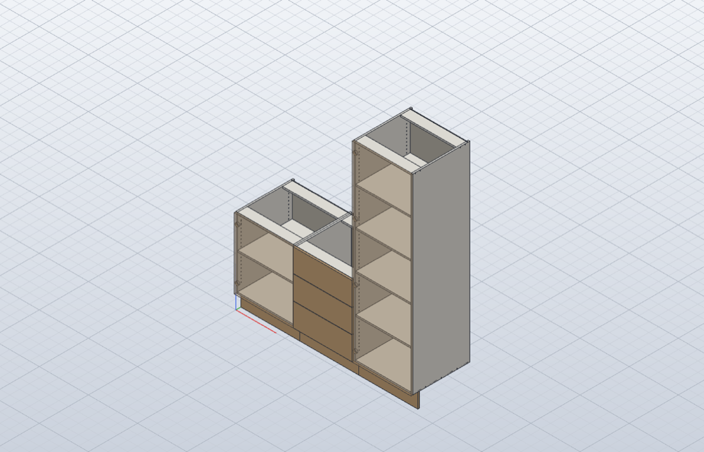

# Performance against SolidCraft

Measured headless with `solidcraft-cli 0.20.0` (the macOS universal CLI from the v0.20.0 release)
on an Apple M1 MacBook Air (MacBookAir10,1, macOS 26.5), `run --timings --profile`. Times are
wall-clock per command as the CLI reports them; "boolean %" is the kernel's boolean share from
`--profile`.

## PERF-2: cost per command on a 16 mm panel

One 16 × 560 × 720 mm panel (a base side), then N features cut into its inner face, one command
each. "first / middle / last" are the 1st, N/2-th and N-th cut, so the growth as the panel gains
features shows. The sketch row is one sketch with N Ø5 circles and **one** `solid.extrude` cut;
its three columns are that single extrude. Reproduce with:

```bash
cargo run -q -p solidcraft-bridge --example perf_probe -- --cli /path/to/solidcraft-cli --count 60
```

| command | features | first ms | middle ms | last ms | total ms | boolean % |
|---|---:|---:|---:|---:|---:|---:|
| solid.box (new panel) | 15 | 1.1 | 0.5 | 0.5 | 6.3 | 0 |
| solid.box cut (4 × 20 × 12) | 15 | 4.0 | 7.3 | 13.8 | 126.7 | 93 |
| solid.cylinder cut (Ø5 × 10) | 15 | 14.6 | 32.7 | 53.6 | 479.7 | 97 |
| sketch + one extrude cut (Ø5 × 10) | 15 | 133.2 | 133.2 | 133.2 | 135.0 | 87 |
| solid.box (new panel) | 60 | 0.8 | 0.6 | 0.8 | 34.8 | 0 |
| solid.box cut (4 × 20 × 12) | 60 | 3.8 | 20.3 | 29.4 | 1 049.5 | 95 |
| solid.cylinder cut (Ø5 × 10) | 60 | 13.9 | 98.9 | 181.9 | 5 808.3 | 98 |
| sketch + one extrude cut (Ø5 × 10) | 60 | 508.4 | 508.4 | 508.4 | 525.3 | 86 |
| solid.box (new panel) | 120 | 0.8 | 0.8 | 1.4 | 100.7 | 0 |
| solid.box cut (4 × 20 × 12) | 120 | 3.2 | 160.6 | 69.0 | 10 764.8 | 93 |
| solid.cylinder cut (Ø5 × 10) | 120 | 14.5 | 182.5 | 396.9 | 37 319.7 | 97 |
| sketch + one extrude cut (Ø5 × 10) | 120 | 1 067.1 | 1 067.1 | 1 067.1 | 1 125.9 | 83 |

What it says:

- A cylinder cut costs about 14 ms on a plain panel plus about **3 ms for every feature already
  on it**, so N cuts on one panel cost O(N²): 120 shelf-pin holes take 37 s.
- A box cut grows the same way, about 5× more slowly per feature (planar faces are cheaper for the
  boolean than cylinders).
- One extrude of a sketch with N circles costs about 9 ms per hole and does not grow with N:
  **11× faster at 60 holes, 33× at 120**.
- New panels are free (< 1.5 ms).

### The sample run before PERF-1

`emit_base --manufacturing` (base, drawer bank, tall: 475 commands): **99.9 s**, of which the 393
`solid.cylinder` cuts take 99.3 s, the 64 boxes (panels and slot cuts) 0.6 s and everything else
under 0.1 s.

## PERF-1: one extrude per panel face

Manufacturing detail now draws every bore on one face of a panel (same direction and depth) as
circles in one sketch and cuts them with one `solid.extrude`, instead of one `solid.cylinder` cut
per hole. Slots and grooves stay box cuts: they cost little (see above).

`emit_base --manufacturing --script target/run.json`, then `solidcraft-cli run --timings`:

| cabinet | before: commands | before: s | after: commands | after: s |
|---|---:|---:|---:|---:|
| B01 base | 130 | 10.44 | 166 | 1.38 |
| D01 drawer bank | 55 | 1.39 | 79 | 0.38 |
| **T01 tall** | 290 | **88.09** | 326 | **3.87** |
| run | 475 | 99.9 | 571 | 5.6 |

The geometry is unchanged: `solidcraft-cli eval` of both scripts gives the same 31 bodies, and every
body's volume matches the cylinder version to within 3 × 10⁻¹⁰ (relative).

These are headless CLI times. The 121 s the owner saw for the tall cabinet was in the desktop app
over the control socket, which also redraws; the connected run has not been re-timed yet.



## JOIN-2: true biscuit slot shape (Exact detail)

A plunged 100 mm cutter leaves a lens: a circular segment into each panel. Drawn as true arcs,
SolidCraft 0.20 needs ~9 s for one slot extrude in a tall cabinet's sides and its kernel logs
`tolerance must be no less than 1e-6` panics (recovered). Drawn as 4 chords per side with the
in-between vertices lifted so the polygon keeps the segment's exact area (the apex stays at the
plunge depth), the volume matches the analytic lens (headless test, ±1 %), but every later cut in
those panels slows down: the sloping faces cost more than the box slots' flat ones, in either
order (bores first or slots first) and whether one extrude cuts all three panels or one each.

| sample run | base s | drawer bank s | tall s | total s |
|---|---:|---:|---:|---:|
| Manufacturing (box slots) | 1.35 | 0.37 | 3.85 | 5.57 |
| Exact (lens slots) | 6.56 | 1.67 | 12.20 | 20.43 |

So Manufacturing keeps box slots (PERF-1's < 10 s), and the lens shape is the opt-in `Exact`
level (app: SolidCraft menu › Detail; `emit_base --exact`).
